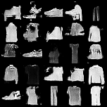

# Fashion Lab — DCGAN on FashionMNIST

A small local Streamlit application that trains a Deep Convolutional GAN (DCGAN) on FashionMNIST and generates 28 × 28 grayscale clothing-like images. It runs the actual PyTorch model locally; it does not call a hosted image-generation API.

## Features

- Train controls for additional epochs, batch size, learning rate, and compute device
- In-app light/dark mode switch, including a matching loss chart
- Live epoch progress and fixed-noise sample previews
- Generator/discriminator loss history in `outputs/losses.csv`
- Latest resumable checkpoint plus per-epoch generator checkpoints
- Gallery for epoch snapshots and newly generated samples
- CPU support; CUDA is offered when PyTorch detects a compatible GPU

## Run locally

Python 3.11 is recommended (Python 3.10–3.13 should also work with a compatible PyTorch wheel).

```powershell
cd FashionDCGAN
py -3.11 -m venv .venv
.\.venv\Scripts\Activate.ps1
python -m pip install -r requirements.txt
python -m streamlit run app.py
```

On macOS/Linux, activate the environment with `source .venv/bin/activate`.

For an NVIDIA GPU on Windows, install the CUDA-enabled PyTorch wheels before the rest of the requirements:

```powershell
python -m pip install torch==2.12.0+cu132 torchvision==0.27.0+cu132 --index-url https://download.pytorch.org/whl/cu132
```

Then install the remaining packages with `python -m pip install -r requirements.txt`. CPU users can skip the CUDA command.

The CUDA wheels are large. Check that `torch.cuda.is_available()` returns `True`; the app's **Compute device** selector then offers CUDA. With the standard requirements, the app can still train on CPU.

FashionMNIST is stored beneath `FashionDCGAN/data/FashionMNIST`. Torchvision downloads it on the first run if it is not already there. Training outputs are saved beneath `FashionDCGAN/outputs/`.

## Use the app

1. Choose training epochs, batch size, learning rate, and compute device in **Train model**.
2. Select **Start training**. The progress display updates after each epoch with losses and a fixed-noise sample grid.
3. Open **Image gallery** to compare epoch snapshots or generate new samples from the saved checkpoint.

The model uses a 100-dimensional Gaussian noise vector. Its generator projects noise to a 7 × 7 feature map, upsamples to 28 × 28, and applies `tanh`; the discriminator downsamples images and outputs a real/fake logit. The two networks train adversarially with `BCEWithLogitsLoss` and Adam.

## Output files

```text
outputs/
├── checkpoints/
│   ├── latest.pt
│   └── generator_epoch_NNN.pt
├── losses.csv
└── samples/
    ├── epoch_NNN.png
    └── latest_gallery.png
```

The checkpoint contains both network weights and optimizer states. Starting another training run resumes from `latest.pt`; the epoch control specifies how many additional epochs to run. Losses are appended to the CSV for comparison across runs.

## Included demo run

The saved sample grids and loss log include a 10-epoch run on an NVIDIA RTX 5050 Laptop GPU. Generator loss moved from **3.132** at epoch 1 to **2.296** at epoch 10; discriminator loss moved from **0.224** to **0.472**. In this early run the generated shapes become more clothing-like, while the adversarial losses alone are not a quality score.



## Project structure

```text
FashionDCGAN/
├── app.py
├── backend/
│   ├── dataset.py
│   ├── models.py
│   └── training.py
├── requirements.txt
└── README.md
```
